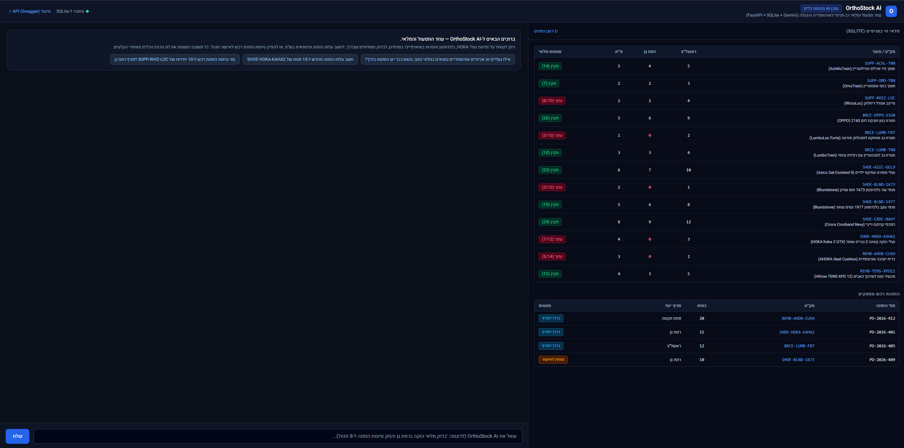

# OrthoStock AI — Multi-Branch Orthopedic & Medical Inventory Copilot

An agentic operations copilot built with **FastAPI**, **SQLite**, and **Gemini Function Calling** (`google-genai`), featuring a full **RTL Hebrew** operational dashboard. Designed to bridge natural-language queries with deterministic relational SQL queries, human-in-the-loop write guardrails, and live tool-execution observability.



## Key Engineering Highlights

* **Deterministic SQL Tool Layer (`app/tools.py`):** Instead of allowing raw LLM-generated SQL (which risks SQL injection or hallucinated schemas), the agent invokes 5 typed Python tools backed by parameterized SQLite queries across normalized tables (`warehouses`, `products`, `stock_levels`, `purchase_orders`).
* **Full RTL Hebrew & Bilingual Support:** End-to-end Hebrew dashboard (`dir="rtl"`) and branch/catalog normalization supporting Hebrew branch names (`ראשון לציון`, `רמת גן`, `פתח תקווה`) alongside English/alphanumeric SKUs.
* **Human-in-the-Loop Write Guardrails:** Read tools (`search_inventory`, `get_low_stock_alerts`, `check_incoming_orders`, `calculate_restock_cost`) execute immediately, while state-mutating actions (`draft_purchase_order`) enforce quantity bounds (`1–500`) and restrict database inserts to `PENDING_APPROVAL` status for manager sign-off.
* **Execution Observability & Model Failover (`app/agent.py`):** Multi-turn agentic loop capturing per-tool arguments, raw JSON payloads, execution latency (ms), and token usage, paired with automatic model fallback (`gemini-4-hydrogen` → `gemini-3.5-flash-lite`) on transient `429`/`503` spikes.
* **Automated Evaluation Suite (`tests/test_agent.py`):** `pytest` suite validating SQL aggregations, bulk discount math, guardrail rejections, and live multi-tool chaining.

## Tech Stack

* **Backend:** Python 3.14, FastAPI, Uvicorn, Pydantic
* **Database:** SQLite (`sqlite3` with relational foreign keys & parameterized queries)
* **AI / LLM:** Google Gemini API (`google-genai` SDK with manual tool-execution loop)
* **Frontend:** HTML5, Tailwind CSS, Marked.js (RTL Hebrew UI)
* **Testing:** Pytest

## Project Structure

```text
nexus-stock-agent/
├── app/
│   ├── agent.py       # Gemini tool-calling loop, observability metrics, and model fallback
│   ├── database.py    # SQLite schema creation and synthetic orthopedic catalog seed
│   ├── main.py        # FastAPI endpoints (/chat, /inventory, /health, /)
│   └── tools.py       # 5 deterministic SQL tools with Hebrew/English branch normalization
├── static/
│   └── index.html     # Split-screen RTL Hebrew dashboard & collapsible Agent Tool Trace
├── tests/
│   └── test_agent.py  # Unit & integration tests for SQL tools, guardrails, and live agent
└── requirements.txt